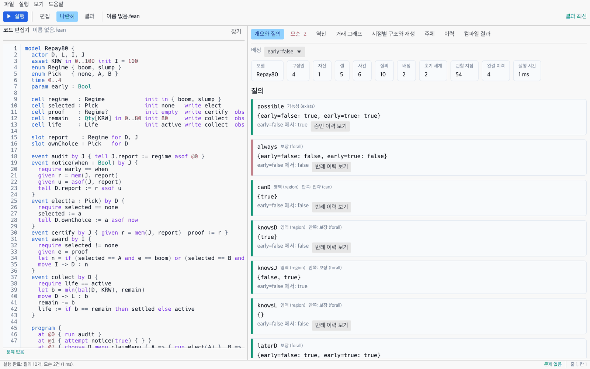
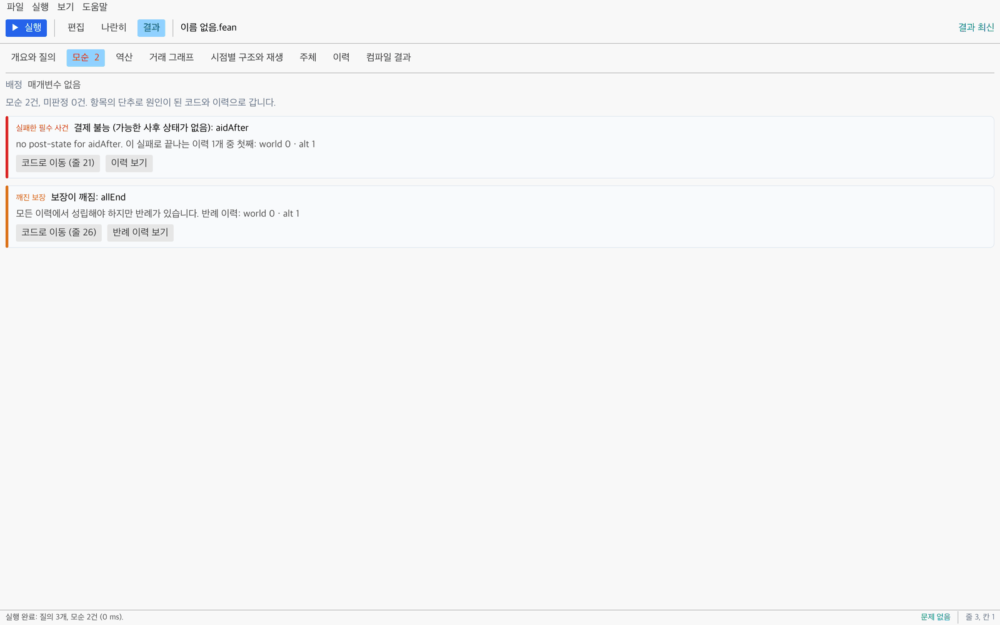
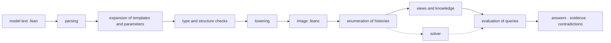
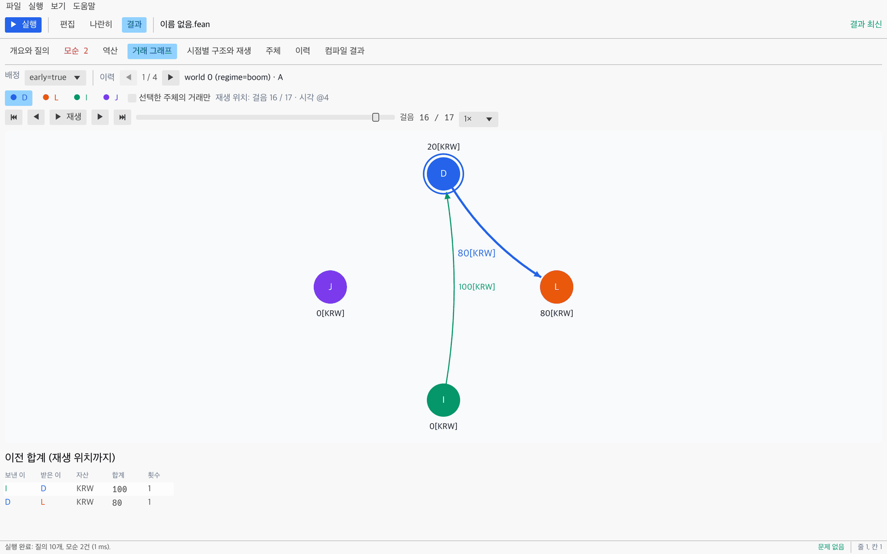
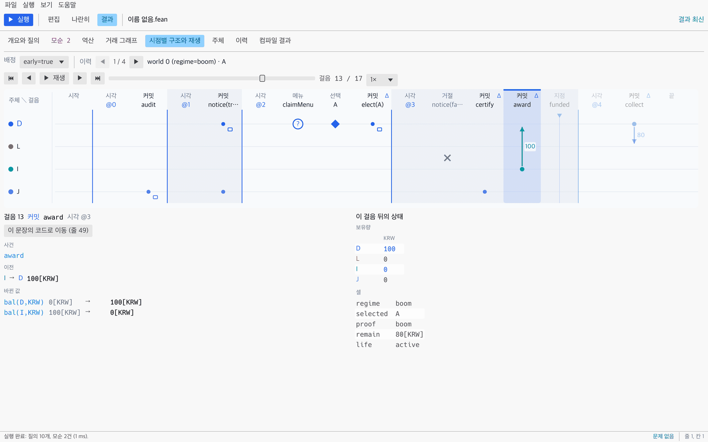
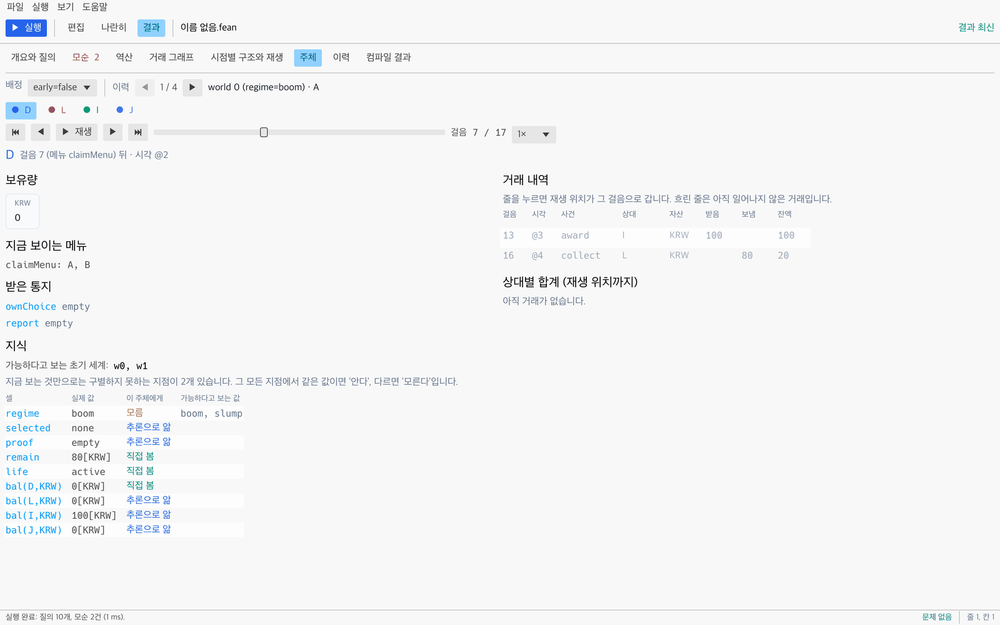
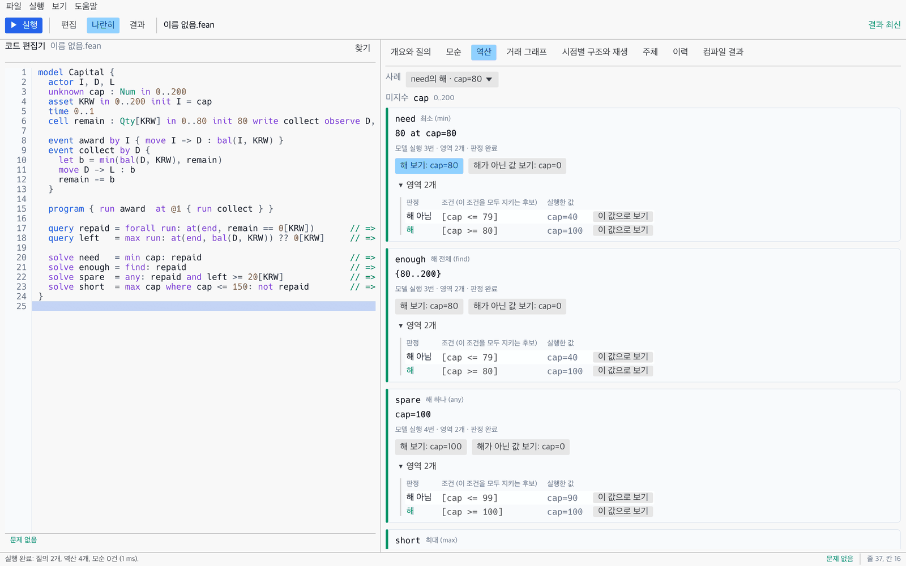

<div align="center">

<h1>FEAN</h1>

<p><b>A formal language, an engine and an IDE that find the contradictions in a financial deal structure once you write it down</b></p>

<p><a href="README.md">한국어</a> · English</p>

<p>
  
  
  
  
  
</p>

<p>
  <a href="#glance">At a glance</a> ·
  <a href="#principle">How it works</a> ·
  <a href="#install">Installation</a> ·
  <a href="docs/financial-language.md">Language specification</a> ·
  <a href="docs/manual/FEAN-IDE-설명서.pdf">IDE manual</a> ·
  <a href="docs/engine.md">Engine document</a>
</p>

</div>

<p align="center">
  
</p>
<p align="center"><i>The FEAN IDE. Write a model on the left and run it; the answers to its queries, and the evidence for them, appear on the right.</i></p>

FEAN is a formal language for writing a financial deal structure, made of contracts, transfers, notices and choices among several actors, as one text (a model). The engine checks and compiles that text before running it, and then follows every history that can happen within the declared ranges, leaving none out. It reports the promises that cannot be kept and the clauses that cannot hold together, each with the line that caused it and a counterexample history.

- **A statement-style formal language.** A deal structure is written with actors, assets, state cells, events, a program and queries. Sale, loan, right and call option come as 4 standard contracts written in the language itself.
- **Checks before running.** Adding amounts of different units, an event that reduces someone else's holding without a ground, a commit that writes one cell twice: all are rejected before anything runs. There are 42 named rules, so an error says at once which rule was broken on which line.
- **Exhaustive exploration.** Every possible initial world, order of events, choice of an actor and candidate settlement is unfolded. Failed paths are not erased.
- **Who knows what.** Each actor sees its own part of the state, and can only choose the same way when it sees the same thing. "There is such a case" and "it can be guaranteed" are told apart.
- **Answers that come with evidence.** Every answer carries a witness history, a counterexample history or the strategy that was found, and each can be replayed step by step.
- **Solving backwards.** FEAN solves for what must have which value for a goal to hold. Even over the range 0..1,000,000,000 it gives the same answer as trying the values one by one.
- **An IDE.** Editing, running, reading the results (8 views) and jumping back to the code go round in one window.
- **Two engines held against each other.** The Python engine is the reference; the Rust engine provides the speed, the solver and the IDE. From the same text the two produce the same image, byte for byte.

**Contents** · [The problem](#problem) · [At a glance](#glance) · [Core premises and axioms](#premises) · [How it works](#principle) · [Installation](#install) · [Using the IDE](#ide) · [Using the command line](#cli) · [Examples](#examples) · [Documentation](#docs) · [Verification and limits](#verification) · [Repository layout](#layout) · [Contributing](#contributing) · [License](#license)

<a id="problem"></a>
## The problem: the cognitive load of spotting a contradiction in a deal structure

Judging whether a financial deal structure contradicts itself takes a heavy cognitive load. Each clause can be understood when it is read. But a contradiction does not sit in one clause; it sits where clauses meet order, time and information. To see it, all of the following have to be held in the head at once.

| What has to be held in the head | Why it is missed | Case |
|---|---|---|
| How clauses interlock | "If it is still unpaid after the support, support it with 100 won" and "it is unpaid if the support is less than 100 won" are each fine when read alone. No state satisfies both. | [`support.fean`](examples/support.fean) |
| Order | A fund has to sell 2 shares to repay 180 won. If the cancellation of 1 share of the 100-won order comes before the fill, 170 won comes in; if after, 200 won. The same contract is repaid in one order and falls short in the other. | [spec 3.4](docs/financial-language.md#execution) |
| How it is settled | Two parties each owe the other 100 won and both hold 0 won of cash. Paid one at a time (gross), neither can pay first; it settles only in a batch for which the system allows netting. | [`mutualdebt.fean`](examples/mutualdebt.fean) |
| Information | In the same contract, if the notice arrives at time 1 the debtor can guarantee repayment, and if it arrives at time 3 the debtor cannot. "There is a case where it is repaid" and "repayment can be guaranteed" are different. | [`repay80.fean`](examples/repay80.fean) |
| The number of cases | The region of prices where repayment is guaranteed splits into `{0..90, 110..200}`. A few representative scenarios miss the stretch in the middle. | [`straddle.fean`](examples/straddle.fean) |
| Failures that get erased | If failed paths are erased and only the rest is looked at, "it holds in every case" becomes vacuously true. | [spec 5.3](docs/financial-language.md#queries) |

These six multiply one another. The price example above alone has 201 prices, and a person looks at only the few that stand out.

FEAN moves this load out of the head and into a text and a machine. A person writes the clauses one by one, each with only what can be seen at that spot: who moves what, under which condition. What happens when the clauses interlock as a whole is computed by the engine, by fixed rules and without leaving anything out, and every answer comes with a history that can be followed step by step.

<a id="glance"></a>
## At a glance

This model writes one support agreement in two ways. G supports F with 100 won if F is short of funds. The event `aidAfter` reads "short" in the state **after** the support, and the event `aidBefore` reads it in the state **before** the support.

```fean
model Support {
  actor G, F
  asset KRW in 0..100 init G = 100
  time 0..0
  cell aid    : Qty[KRW] in 0..100 init 0     write aidAfter, aidBefore
  cell unpaid : Bool               init false write aidAfter, aidBefore

  event aidAfter by G {
    free aid  free unpaid
    ensure post(aid) == (if post(unpaid) then 100[KRW] else 0[KRW])
    ensure post(unpaid) == (post(aid) < 100[KRW])
  }
  event aidBefore by G {
    let short = bal(F, KRW) < 100[KRW]
    free aid  free unpaid
    ensure post(aid) == (if short then 100[KRW] else 0[KRW])
    ensure post(unpaid) == (post(aid) < 100[KRW])
  }

  program {
    alt { attempt aidAfter { label afterOk } } or { run aidBefore  label beforeOk }
  }

  query circular = exists run: reach(afterOk)                                 // => false
  query prior    = exists run: at(beforeOk, aid == 100[KRW] and not unpaid)   // => true
  query allEnd   = forall run: reach(end)                                     // => false
}
```

With nothing but Python it runs right where the repository was checked out.

```bash
python3 -m fean run examples/support.fean
```

```text
circular = false
prior    = true
allEnd   = false
```

- `circular = false`: no history lets `aidAfter` happen. If it is unpaid, 100 won must be given, and then it is not unpaid; if it is not unpaid, the support is 0 won, and then it is unpaid. No post-state satisfies both `ensure` clauses.
- `prior = true`: `aidBefore` looks only at the shortfall before the support, so the outcome is fixed: 100 won of support and nothing unpaid.
- `allEnd = false`: so not every history reaches the end. The branch that tried `aidAfter` ends with no settlement (`NO_SETTLEMENT`).

[Once the Rust engine is built](#install), the contradictions the engine collected can be had with their line numbers.

```bash
dist/fean inspect examples/support.fean | python3 -c "import json,sys; [print(f['line'], f['title']) for f in json.load(sys.stdin)['findings']]"
```

```text
21 결제 불능 (가능한 사후 상태가 없음): aidAfter
26 보장이 깨짐: allEnd
```

The two lines read "no settlement (no possible post-state): aidAfter" and "guarantee broken: allEnd". The `모순` (Contradictions) view of the IDE shows the same list, and the buttons of an entry go straight to the line that caused it and to the counterexample history.

<p align="center">
  
</p>

<a id="premises"></a>
## Core premises and axioms

Every verdict of FEAN stands on the premises and axioms below. A premise is an assumption that whoever writes the model accepts; an axiom is a rule that the language and the engine keep without exception. The link at the end of an item is the section of the [language specification](docs/financial-language.md) that defines it.

### Premises

1. **What is declared is all there is.** What is analysed is the initial state, the institutions (events, batches, the program), the passing of information and the possible outside events written in the model. What is not written does not happen. An outside shock, too, has its possible values written in the initial worlds or in a branch (`alt`) of the program. ([spec §1](docs/financial-language.md#language))
2. **The actual world is one of the declared possible worlds.** A fact that is not known is not fixed to one value; it is written as a set of possible initial worlds. A verdict is about that whole set. ([spec 3.1](docs/financial-language.md#execution))
3. **The model is finite and every run ends.** The initial worlds, the ranges of amounts, the times and the choices are finite, and a program has no loops. That is why "every case" can really be looked at. ([spec 3.3](docs/financial-language.md#execution))
4. **Information, probability and preference exist only as far as they are declared.** An actor comes to know something only by a notice (`tell`) or by observation (`observe`, and its own holdings). Probability exists only as a weight given to initial worlds (`weight`), and valuation only as a declared value (`value`). What an actor actually believes is not guessed. ([spec 4.2](docs/financial-language.md#epistemics), [5.1](docs/financial-language.md#queries))

### Axioms

1. **Atomicity.** A commit (one event, or a declared batch) happens entirely or not at all. Conditions and the right-hand sides of effects are all read in the same pre-state. ([spec 3.2](docs/financial-language.md#execution))
2. **Conservation of quantity.** A holding changes only by a transfer (`move`) or by a creation or destruction that states its authority (`auth`). So for every asset, closing quantity = opening quantity + inflow − outflow + creation − destruction. An event that reduces someone else's holding without a ground is rejected before anything runs (`W-Debit`). ([spec §6](docs/financial-language.md#library))
3. **Funds are counted gross.** What goes out must be within what was held before the commit. Netting, where money coming in pays for money going out, holds only when `net` is declared on an event or a batch for which the system allows it. ([spec 3.2](docs/financial-language.md#execution))
4. **A failure is not erased.** When a required event fails, the history stays as a leaf together with its cause. It is `BLOCKED` when a condition, an authority or the funds are false, and `NO_SETTLEMENT` when the conditions pass but no post-state satisfies the ranges, the invariants and the postconditions together. In a failed history "it holds at the end" is false, so a guarantee never becomes vacuously true. ([spec 3.2](docs/financial-language.md#execution), [5.3](docs/financial-language.md#queries))
5. **The same choice for the same view.** An actor's strategy is a function of what it can see (the public time, the menu shown, the notices received, the values observed). It cannot choose differently according to a fact it does not know. That every world has a fitting action, and that one policy keeping the information constraints works in every world, are different things. ([spec 4.3](docs/financial-language.md#epistemics))
6. **What is known is true.** `K(i, φ)` means that φ is true at every point compatible with what i can see. Receiving a report does not make its content true; a fact, a memory and an accepted proof are written separately. ([spec 4.3](docs/financial-language.md#epistemics))
7. **A wrong text does not run.** An expression that passed the checks yields a value of its type in every state. So mistakes of type, unit, authority and structure all show before running, whether or not the line would ever be reached. ([spec 2.3](docs/financial-language.md#types))

<a id="principle"></a>
## How it works: how the compiler and the engine find contradictions

### What counts as a contradiction

A contradiction is a place where the model disagrees with itself. The engine collects the five kinds below.

| Contradiction | Meaning | When it shows |
|---|---|---|
| Compile error | The text breaks the syntax or a rule: adding won to dollars (`T-Arith`), or reducing someone else's holding without a ground (`W-Debit`). | Before running |
| Run error | With the values put in, the model is invalid: for instance there is no possible initial world at all (`D-Init`). | Just before and during a run |
| Failed required event | An event that must happen is blocked (`BLOCKED`) or has no settlement (`NO_SETTLEMENT`). | While histories are unfolded |
| Broken guarantee | "It holds in every history" (`forall`) or "this actor can guarantee it" (`can`) is false. A counterexample history is attached. | While queries are evaluated |
| No solution | No value satisfies both the constraint and the goal of a solve query. | While solving backwards |

"Is there such a history" (`exists`) being false is not counted as a contradiction; it is only the answer that there is no such possibility. What could not be decided because the search limit was passed is written separately as `UNKNOWN`. The engine says it does not know rather than give a wrong answer.



### 1. Filter before running

The compiler reads the text into a syntax tree, expands contract templates, procedures and parameters into finitely many basic declarations, and checks them with the rules of types, layers and structure. A model that passes is lowered to an image (`.feanc`) in which names have become numbers and expressions have become code for a stack machine. A text that breaks a rule is rejected as `file:line: [rule] message` and is not run.

### 2. Unfold every possible history

The machine runs the program of the image one step at a time. Histories part where there are several initial values, where the environment picks a branch (`alt`) or an actor makes a choice (`choose`), or where a commit has several post-states. The machine follows all of them. There are no loops, so every history ends, and a history that ended in failure stays in the result.

### 3. Solve the joint conditions of every commit

The post-states a commit U can reach from a pre-state s are the set below.

```math
\operatorname{Next}_U(s)=\{\,s' \mid \operatorname{Pre}_U(s)\land\operatorname{Fund}_U(s)\land R_U(s,s')\land\operatorname{Range}(s')\land\operatorname{Inv}(s')\land\operatorname{Post}_U(s,s')\,\}
```

If the conditions and authorities (Pre) or the funds (Fund) are false, the verdict is `BLOCKED`. Otherwise the cells left undetermined (`free`) are enumerated over their ranges to make candidates, and only those that satisfy the ranges (Range), the invariants (Inv) and the postconditions (Post) together are kept. If none is left, the verdict is `NO_SETTLEMENT`: the clauses cannot hold together. The `aidAfter` of the example above is this case.

### 4. Compute knowledge over the histories

Transitions do not depend on knowledge. So the set of histories is built first, and on top of it the points an actor sees alike are grouped. Writing I<sub>i</sub>(p) for the group of points i cannot tell from p, knowledge is as follows.

```math
M,p\models K(i,\varphi)\iff\forall q\in I_i(p),\ M,q\models\varphi
```

### 5. Evaluate queries as defined and keep the evidence

| Query | What it asks | Evidence attached |
|---|---|---|
| `exists run: φ` | Is there at least one history where φ holds | A witness history if true |
| `forall run: φ` | Does φ hold in every history | A counterexample history if false |
| `can {C}: φ` | Is there a policy by which C guarantees φ with only its own information | The policy if true, a counterexample history if false |
| `max run: e`, `min run: e`, `expect w: …` | The maximum, minimum or expected value over histories | The history that gives the value |
| `region p: Q` | The set of parameter values for which Q is true | The set itself |
| `prefer i at menu(m): a over b by v` | Is a better than b in every information set | The valuation in each information set |

### 6. Solve backwards

A constant left without a value is declared `unknown`, and `solve` asks for the values that make a goal hold. The answer is defined as the result of trying the candidates one by one, and the Python engine computes it as defined. The solver of the Rust engine runs the model and records the decisions that depend on the unknowns (comparisons, ranges, funds) as linear conditions, which divides the candidates into regions with the same verdict. So it runs not as many times as there are candidates but as many times as there are boundaries where the result changes. For `need = min cap: repaid` of the example `Capital`, 3 runs give `[cap <= 79]` (not a solution) and `[cap >= 80]` (a solution). The method of the solver is in the [engine document](docs/engine.md#solver), and how its answers are held against the definition is in [Verification and limits](#verification).

### 7. Collect the contradictions and lead back to their causes

The failed required events, the broken guarantees, the run errors and the solve queries without a solution are collected, each with the line that caused it and the step of the history where it happened. On the command line `fean inspect` shows this list; in the IDE the `모순` (Contradictions) view does.

### Background

The meaning of knowledge follows [Halpern–Moses on individual states and the semantics of knowledge](https://www.cs.cornell.edu/home/halpern/papers/common_knowledge.pdf), the distinction between a fact and a proof follows [Hart–Holmström on observable versus verifiable](https://economics.mit.edu/sites/default/files/2022-09/Theory%20of%20Contracts-1987.pdf), the distinction between gross and net follows [the rules on linked settlement in the Principles for financial market infrastructures](https://www.bis.org/publications/principles-financial-market-infrastructures.pdf), and exhaustive checking follows [finite-state model checking](https://www-users.cse.umn.edu/~heimdahl/csci8801-fall06/readings/model-checking-clarke.pdf). Where and how each is used is in the corresponding section of the specification.

<a id="install"></a>
## Installation

| To use | You need |
|---|---|
| The Python engine | Python 3.9 or later. Only the standard library is used (confirmed on 3.9, 3.10, 3.13 and 3.14). |
| The Rust engine and the IDE | Rust 1.95 and Cargo. If you do not have them, install them with [rustup](https://rustup.rs). |
| The full set of checks | Both of the above, and the Python packages Pillow and pypdf |

The Python engine needs no build. In the folder where the repository was checked out, the command in [At a glance](#glance) runs as it is. The Rust engine and the IDE are built with the one line below.

```bash
bash rust/build.sh
```

Two executables appear in `dist/`. The first build also downloads and compiles the GUI library, so it takes a little while.

| File | What it does |
|---|---|
| `dist/fean` | The command-line engine. It compiles, runs and checks without a window. |
| `dist/fean-ide` | The IDE |

- The intermediate build products go to `~/Library/Caches/fean-rust-target`. Set `CARGO_TARGET_DIR` to put them elsewhere.
- It was built and tested on macOS (Apple Silicon). Other operating systems have not been confirmed yet.
- The screen of the IDE is in Korean, and it reads a Korean font from the system.

<a id="ide"></a>
## Using the IDE

```bash
dist/fean-ide
```

```bash
dist/fean-ide examples/repay80.fean
```

Without a file, the example `Repay80` of the specification opens. The window is divided into the code editor on the left and the result views on the right. Results are only looked at, never edited. Clicking an element of a result takes the editor to the line that wrote it; you fix it there and run again. The cycle **edit → run → inspect → jump to code** is what the tool is for.

### A short tour

1. **Run.** Press the `▶ 실행` (Run) button on the toolbar, or <kbd>⌘R</kbd>. The results appear on the right.
2. **Read the answer to a query.** In `개요와 질의` (Overview and queries) the answer of `always` is `{early=false: false, early=true: false}`. It means the debt is not fully repaid in every history.
3. **See why.** Press `반례 이력 보기` (show the counterexample history) on the card of `always`, and that history unfolds in `시점별 구조와 재생` (Timeline and replay). Move one step at a time with <kbd>←</kbd> and <kbd>→</kbd> and see what changes at which step.
4. **Go back to the code.** Clicking the name of an event in the details of a step takes the editor to the line that declares it.
5. **Fix and run again.** Change `init I = 100` to `init I = 60` in the editor and run again: the number of contradictions goes from 2 to 8. There is not enough money to give, so the required event `award` is blocked, and the guarantees after it break with it.

### The result views

| View | What it shows |
|---|---|
| `개요와 질의` | Overview and queries: the size of the model and the answer to each query. An answer carries a witness history, a counterexample history or the strategy that was found. |
| `모순` | Contradictions: compile errors, run errors, failed required events, broken guarantees, solve queries without a solution |
| `역산` | Solving backwards: the unknowns, the answers to the solve queries and the table of regions with the same verdict. The model can be run at a solution and at a value that is not one. |
| `거래 그래프` | Transaction graph: who sent how much to whom, summed up to the replay position. |
| `시점별 구조와 재생` | Timeline and replay: the steps laid in time order on one row per actor, replayed one step at a time. |
| `주체` | Actor: one actor's holdings, the notices it received, its ledger, and what it knows and does not know at that point |
| `이력` | Histories: the table of all complete histories, and the tree of the points where histories part |
| `컴파일 결과` | Compile result: the size and the listing of the image. The image can be saved to a file. |

<table>
  <tr>
    <td width="50%"><a href="docs/manual/img/05-graph.png"></a><br><sub>Transaction graph: who sent how much to whom</sub></td>
    <td width="50%"><a href="docs/manual/img/06-timeline.png"></a><br><sub>Timeline and replay: steps across, actors down</sub></td>
  </tr>
  <tr>
    <td width="50%"><a href="docs/manual/img/07-actor.png"></a><br><sub>Actor: what it holds and what it knows at that point</sub></td>
    <td width="50%"><a href="docs/manual/img/19-solver.png"></a><br><sub>Solving backwards: the answers and the regions with the same verdict</sub></td>
  </tr>
</table>

### The editor and the shortcuts

The editor tells reserved words, numbers and comments apart by colour. Shortly after typing stops it checks the syntax and the rules, and shows the line and the rule name of each error in the list of problems.

| Key | What it does |
|---|---|
| <kbd>⌘R</kbd> / <kbd>F5</kbd> | Run |
| <kbd>⌘1</kbd> · <kbd>⌘2</kbd> · <kbd>⌘3</kbd> | Layout: editor · side by side · results |
| <kbd>⌘F</kbd> | Find |
| <kbd>⌘S</kbd> · <kbd>⌘O</kbd> · <kbd>⌘N</kbd> | Save · open · new file |
| <kbd>←</kbd> · <kbd>→</kbd> | Move the replay position one step back · forward |
| <kbd>Space</kbd> | Play · pause |
| <kbd>⌘+</kbd> · <kbd>⌘−</kbd> | Larger · smaller text |

How to use all 40 features, with pictures of the screen, is in the [IDE manual](docs/manual/FEAN-IDE-설명서.pdf).

<a id="cli"></a>
## Using the command line

There are two engines and the commands are the same. `dist/fean` (the Rust engine) and `python3 -m fean` (the Python engine) give the same output and the same exit code for the same input in `check`, `run`, `compile` and `dump`. The `fean` of the table below can be either. Only solve queries differ. The Python engine tries the candidates one by one, as the definition says, so over a wide range it answers `UNKNOWN`, and it writes a set of solutions with several coordinates as a list of solutions rather than as bundles of conditions.

| Command | What it does |
|---|---|
| `fean check SOURCE` | Checks the syntax and the rules only. |
| `fean run PATH [--json] [--budget N]` | Runs a model text or an image and prints the results of its queries and solve queries. |
| `fean compile SOURCE [-o OUTPUT]` | Compiles a model text into an image file (`.feanc`). |
| `fean dump PATH` | Prints the tables and the code of an image as a listing a person can read. |
| `fean inspect PATH [--views] [--budget N]` | Prints as JSON everything the IDE shows (queries and their evidence, contradictions, histories and steps, the transaction graph, ledgers, the answers and regions of solve queries). Only in the Rust engine. |
| `fean batch` | Carries out a list of jobs (JSON) from standard input in one process. The checks use it. Only in the Rust engine. |

- `--json` prints the results as one JSON object.
- `--budget N` is the search limit, the limit on the number of observation points to make. It defaults to 200,000, and past it the result is `UNKNOWN`.
- `--no-prelude` does not put the standard contracts in front of the text.
- `--views` adds each actor's knowledge at every step to the output of `inspect`.
- `-o OUTPUT` is where the image file goes. Without it the image is written next to the text file, with the same name and `.feanc`.
- When `SOURCE` or `PATH` is `-`, standard input is read.

### Checking

```bash
dist/fean check examples/support.fean
```

```text
examples/support.fean: 검사 통과 (셀 2, 사건 2, 질의 3)
```

The line reads "checks passed" with the numbers of cells, events and queries. A text that breaks a rule is not run. Give a model that adds won to dollars on standard input, and the line number and the rule name come out.

```bash
dist/fean check - <<'EOF'
model Mix {
  actor A, B
  asset KRW in 0..100 init A = 100
  asset USD in 0..100
  time 0..0
  event pay by A { move A -> B : 10[KRW] + 1[USD] }
  program { run pay }
}
EOF
```

```text
<stdin>:6: [T-Arith] Qty[KRW] + Qty[USD]
```

### Running

The results of the solve queries follow those of the queries. In the example below, the least initial funding that guarantees repayment of a debt of 80 won is 80 (`need`), the range of funding that guarantees it is `{80..200}` (`enough`), and the largest funding at or below 150 where the guarantee breaks is 79 (`short`).

```bash
dist/fean run examples/capital.fean
```

```text
repaid = {need: true, enough: true, spare: true, short: false}
left   = {need: 0[KRW], enough: 0[KRW], spare: 20[KRW], short: 0[KRW]}
need   = 80 at cap=80
enough = {80..200}
spare  = cap=100
short  = 79 at cap=79
```

### Compiling and images

```bash
dist/fean compile examples/support.fean -o support.feanc
```

```text
examples/support.fean → support.feanc  (셀 2, 사건 2, 코드 블록 15, 질의 3)
```

```bash
dist/fean run support.feanc
```

```text
circular = false
prior    = true
allEnd   = false
```

Both engines read the image. The same text compiles to the same image, byte for byte, whichever engine compiles it.

### Exit codes

| Exit code | Meaning |
|---|---|
| 0 | Success. It is 0 even when a result is `UNKNOWN`. |
| 1 | A compile error: syntax, a rule, or a damaged image. |
| 2 | A model error that showed while running (`D-Init` and the like). |
| 3 | Input that cannot be read, or wrong usage. |

Errors go to standard error as `file:line: [rule] message`.

### Calling it from Python

```python
import fean

text = open('examples/support.fean').read()
image = fean.compile_source(text)
print(fean.run_image(image))
```

```text
{'circular': 'false', 'prior': 'true', 'allEnd': 'false'}
```

<a id="examples"></a>
## Examples

`examples/` holds the 10 example models printed in the specification. All of them run with the commands above, and their results are the expected results written in the specification.

| Example | What it shows | Result |
|---|---|---|
| [`order.fean`](examples/order.fean) | There is a history that buys 2 shares in the cheap world, but an actor that cannot see the price has no policy that orders a different quantity in each world. | `lucky = true`, `hedged = false` |
| [`mutualdebt.fean`](examples/mutualdebt.fean) | When each owes the other 100 won and the cash is 0 won, the gross batch is refused and only the netted batch settles. | `grossBlocked = true`, `netSettles = true` |
| [`support.fean`](examples/support.fean) | A support agreement whose conditions are each other's post-states has no solution. | `circular = false` |
| [`loanlifecycle.fean`](examples/loanlifecycle.fean) | The life of a loan: interest, partial repayment, assignment of the claim, a repayment refused for lack of funds, arrears | `overdue = 5[KRW]` |
| [`callexample.fean`](examples/callexample.fean) | Exercising and passing a physically settled call option. The holder can guarantee receiving the share; the writer cannot guarantee keeping it. | `holderCan = true`, `writerCan = false` |
| [`repay80.fean`](examples/repay80.fean) | Only on the schedule with the early notice can the debtor guarantee repaying 80 won. | `canD = {true}` |
| [`straddle.fean`](examples/straddle.fean) | The region of prices where repayment is guaranteed splits into two stretches. | `safe = {0..90, 110..200}` |
| [`workout.fean`](examples/workout.fean) | Finds the stretch where the senior and the junior creditor prefer differently between liquidation and forbearance. | `seniorLiquidates = {0..59}`, `juniorDefers = {51..60}` |
| [`capital.fean`](examples/capital.fean) | Solving backwards: the least initial funding that guarantees repayment | `need = 80 at cap=80` |
| [`escrow.fean`](examples/escrow.fean) | Solving backwards: the states at a point of the program from which settlement is guaranteed. When the receiver's holding is at its limit there is no solution. | `full = none` |

<a id="docs"></a>
## Documentation

The documents are in Korean.

| Document | Contents |
|---|---|
| [Language specification](docs/financial-language.md) | The grammar (EBNF) and its 93 reserved words, the named rules of types and structure, the verdict of a commit, histories and knowledge, queries, solving backwards, the standard contracts, a complete case |
| [Engine document](docs/engine.md) | The flow of compilation, the format and the instructions of the image, the machine, the Rust engine, the solver, the scope of verification |
| [IDE manual (PDF)](docs/manual/FEAN-IDE-설명서.pdf) · [source](docs/manual/manual.html) | How to use every feature, pictures of the screen, troubleshooting |
| [v0.1 specification](docs/financial-language-v0.1.md) | The first version, kept as it was. |

<a id="verification"></a>
## Verification and limits

```bash
python3 -m pip install pillow pypdf
```

```bash
bash rust/build.sh
```

```bash
python3 -B -m unittest discover -s tests
```

All 80 checks must pass. Only 4 of them (the ones that read the screens of the IDE and the PDF of the manual) use Pillow and pypdf. When an executable is missing or older than its sources, the checks say to build first and stop. What the checks confirm is this.

- Running every model block of the specification gives the expected result written in the document (`// =>`), to the letter.
- For every rule, a model that breaks it is rejected under the name of that rule.
- From the same text, the reference implementation and the Python engine give the same histories and the same results, and the Python engine and the Rust engine give the same verdicts, the same image byte for byte, the same histories and the same results.
- On the models in the checks, the answers of the solver equal, candidate by candidate, the answers of trying the candidates one by one. Past a limit it gives "undecided" rather than a wrong answer.
- The IDE carries out a fixed scenario by itself in a real window, which confirms that the cycle from editing to jumping to the code goes round.
- The outputs of the commands, the numbers and the links printed in this document are held against the real ones as well.

The limits to know before using it are these.

- **The model is finite.** A verdict is an exhaustive check within the declared finite ranges. To speak about another range, it has to be confirmed again in that range.
- **The model is the premise.** The engine cannot judge whether the text renders a real contract correctly. Legal priority, who is notified of what, and which orders of settlement are allowed are inputs written into the model.
- **Two claims are not machine-proved.** That an expression which passed the checks always yields a value, and that every history is realised by strategies keeping the information constraints, are claims whose grounds are written in the specification.
- **There are limits.** When the number of observation points passes the search limit (it defaults to 200,000), the result is `UNKNOWN`. Solving backwards in the Python engine gives `UNKNOWN` past 200,000 candidates; wide ranges are the job of the solver of the Rust engine.
- **It was tested on macOS only.** The screen of the IDE and the documents are in Korean.
- **It is a draft.** The specification is at version 0.3 and its status is `draft`. The grammar and the meaning may change.
- **It is not advice.** A result is a logical verdict about the model that was written, and is not legal, accounting or investment advice.

<a id="layout"></a>
## Repository layout

| Path | Contents |
|---|---|
| `fean/` | The Python engine (the reference): parsing, checks, lowering, the image, the machine, the command line, the standard contracts |
| `rust/fean-core/` | The Rust engine: compiler, machine, solver, run records |
| `rust/fean-cli/` | The command line `fean` |
| `rust/fean-ide/` | The IDE `fean-ide`. Its screen is drawn with [egui](https://github.com/emilk/egui). |
| `examples/` | The 10 example models of the specification |
| `tests/` | The checks and the reference implementation |
| `docs/` | The specification, the engine document, the manual |

Labels such as `DR-30` or `I-05-c` in the comments of the sources are numbers of design records that are not part of this repository.

<a id="contributing"></a>
## Contributing

Reports of bugs, of models that get a wrong verdict and of mistakes in the documents are welcome. When changing something, please keep to the following.

- A change of behaviour changes the documents with it. The checks hold the documents and the implementation against each other (the expected results of the specification, the feature list of the manual, the outputs in this document), so fixing one side alone does not pass.
- The Python engine is the reference. The Rust engine must give the same image and the same results from the same text.
- Before sending a change, run the full set of checks with the commands in [Verification and limits](#verification).

<a id="license"></a>
## License

It may be used under either of the two licenses below, at your option (`MIT OR Apache-2.0`).

- MIT license: [LICENSE-MIT](LICENSE-MIT)
- Apache License 2.0: [LICENSE-APACHE](LICENSE-APACHE)

Copyright © 2026 Minchan_J
