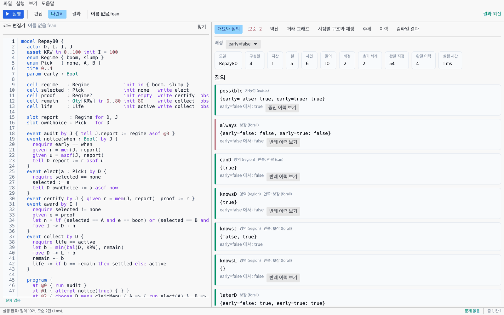
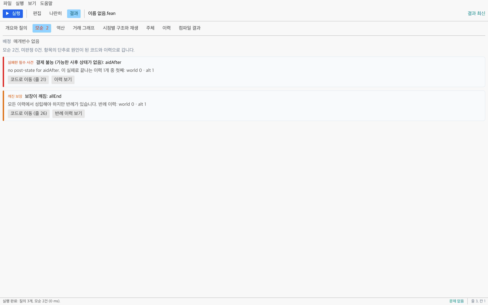
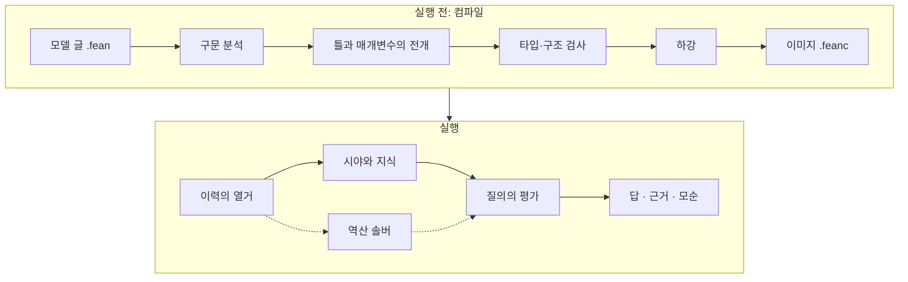
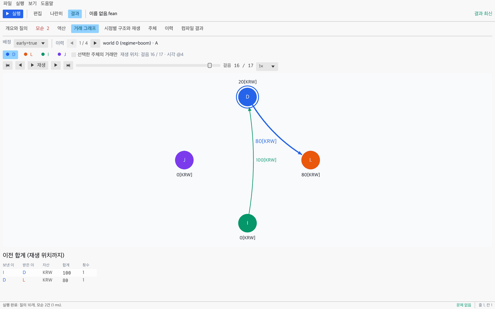
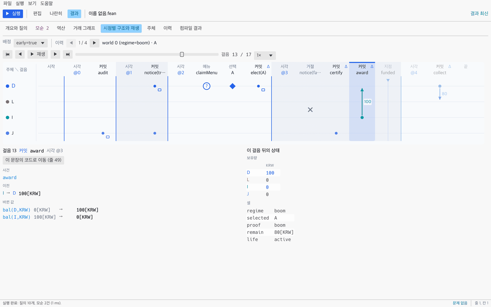
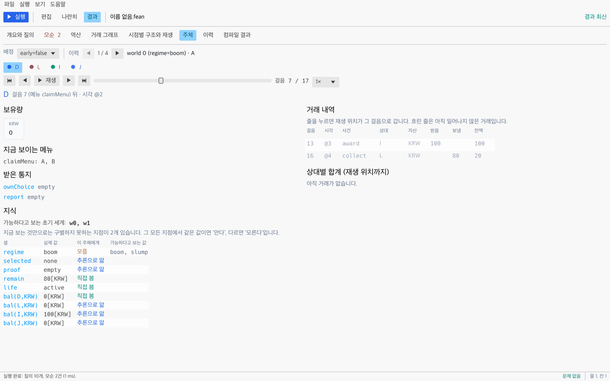
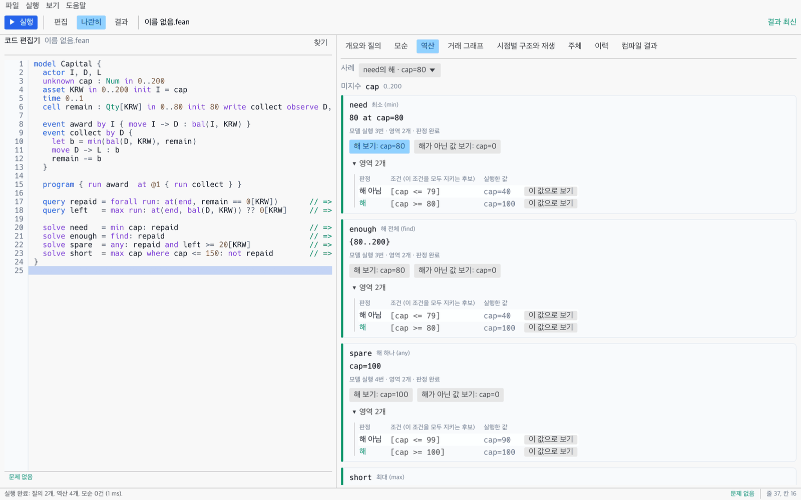

<div align="center">

<h1>FEAN</h1>

<p><b>금융 거래 구조를 글로 적으면, 그 안의 모순을 찾아 주는 형식언어 · 엔진 · IDE</b></p>

<p>한국어 · <a href="README.en.md">English</a></p>

<p>
  
  
  
  
  
</p>

<p>
  <a href="#glance">한눈에 보기</a> ·
  <a href="#principle">원리</a> ·
  <a href="#install">설치</a> ·
  <a href="docs/financial-language.md">언어 명세</a> ·
  <a href="docs/manual/FEAN-IDE-설명서.pdf">IDE 설명서</a> ·
  <a href="docs/engine.md">엔진 문서</a>
</p>

</div>

<p align="center">
  
</p>
<p align="center"><i>FEAN IDE. 왼쪽에 모델 글을 쓰고 실행하면 오른쪽에 질의의 답과 그 근거가 나옵니다.</i></p>

FEAN은 여러 주체 사이의 계약, 이전, 통지, 선택으로 이루어진 금융 거래 구조를 한 편의 글(모델)로 적는 형식언어입니다. 엔진은 그 글을 실행 전에 검사하고 컴파일한 뒤, 선언한 범위 안에서 일어날 수 있는 모든 이력을 빠짐없이 따라갑니다. 그리고 지킬 수 없는 약속과, 함께 성립할 수 없는 조항들을 찾아 원인이 된 줄과 반례 이력을 붙여 내놓습니다.

- **문장형 형식언어.** 구성원, 자산, 상태 셀, 사건, 프로그램, 질의로 거래 구조를 적습니다. 매매·대차·권리·콜옵션은 언어로 쓴 표준 계약 4개로 들어 있습니다.
- **실행 전 검사.** 단위가 다른 덧셈, 근거 없이 남의 보유량을 줄이는 사건, 한 셀을 두 번 쓰는 커밋은 실행되기 전에 거절됩니다. 규칙 42개에는 저마다 이름이 있어, 오류가 어느 줄의 어느 규칙인지 바로 나옵니다.
- **전수 탐색.** 가능한 초기 세계, 사건의 순서, 주체의 선택, 결제의 후보를 모두 펼칩니다. 실패한 경로도 지우지 않습니다.
- **누가 무엇을 아는가.** 주체마다 시야가 따로 있고, 같은 시야에서는 같은 선택만 할 수 있습니다. ‘그런 경우가 있다’와 ‘보장할 수 있다’를 구별합니다.
- **근거가 붙는 답.** 질의의 답마다 증인 이력, 반례 이력, 찾은 전략이 붙고, 한 걸음씩 재생해 볼 수 있습니다.
- **역산.** 목표가 성립하려면 무엇이 어떤 값이어야 하는지를 거꾸로 풉니다. 범위가 0..1,000,000,000이어도 하나씩 넣어 본 것과 같은 답을 냅니다.
- **IDE.** 편집, 실행, 결과 열람(보기 8가지), 코드로 이동의 순환을 한 창에서 돕니다.
- **서로 맞대는 두 엔진.** Python 엔진이 기준이고, Rust 엔진이 속도와 솔버와 IDE를 맡습니다. 둘은 같은 글에서 바이트까지 같은 이미지를 냅니다.

**차례** · [문제](#problem) · [한눈에 보기](#glance) · [핵심 전제와 공리](#premises) · [원리](#principle) · [설치와 빌드](#install) · [IDE 사용법](#ide) · [명령줄 사용법](#cli) · [예제](#examples) · [문서](#docs) · [검증과 한계](#verification) · [저장소 구성](#layout) · [기여](#contributing) · [라이선스](#license)

<a id="problem"></a>
## 문제: 거래 구조의 모순을 가려내는 데 드는 인지 부하

금융 거래 구조가 스스로 모순되는지를 판단하려면 많은 인지적 부하가 듭니다. 조항 하나하나는 읽으면 이해됩니다. 그런데 모순은 조항 하나에 있지 않고, 조항들이 순서·시간·정보와 맞물리는 곳에 있습니다. 그것을 보려면 아래의 것들을 한꺼번에 머리에 올려놓아야 합니다.

| 머리에 올려놓아야 하는 것 | 왜 놓치는가 | 사례 |
|---|---|---|
| 조항의 맞물림 | “지원한 뒤에도 미지급이면 100원을 지원한다”와 “지원액이 100원에 못 미치면 미지급이다”는 따로 읽으면 멀쩡합니다. 둘을 함께 만족하는 상태는 없습니다. | [`support.fean`](examples/support.fean) |
| 순서 | 펀드가 2주를 팔아 180원을 갚아야 합니다. 100원 주문 1주의 취소가 체결보다 먼저이면 170원, 나중이면 200원이 들어옵니다. 같은 계약이 한 순서에서는 갚아지고 다른 순서에서는 모자랍니다. | [명세 3.4](docs/financial-language.md#execution) |
| 결제 방식 | 두 사람이 서로 100원씩 줘야 하는데 둘 다 현금이 0원입니다. 한 건씩 치르면(총액) 누구도 먼저 줄 수 없고, 제도가 순액결제를 허용한 묶음에서만 끝납니다. | [`mutualdebt.fean`](examples/mutualdebt.fean) |
| 정보 | 같은 계약에서 통지가 시각 1에 오면 채무자가 상환을 보장할 수 있고, 시각 3에 오면 보장할 수 없습니다. ‘갚는 경우가 있다’와 ‘갚는다고 보장할 수 있다’는 다릅니다. | [`repay80.fean`](examples/repay80.fean) |
| 경우의 수 | 상환이 보장되는 가격의 영역이 `{0..90, 110..200}`으로 갈라집니다. 대표 시나리오 몇 개로는 가운데 구간을 놓칩니다. | [`straddle.fean`](examples/straddle.fean) |
| 지워지는 실패 | 실패한 경로를 지우고 남은 것만 보면 ‘모든 경우에 성립한다’가 공허하게 참이 됩니다. | [명세 5.3](docs/financial-language.md#queries) |

이 여섯 가지는 서로 곱해집니다. 위의 가격 예제만 해도 가격이 201가지이고, 사람은 그 가운데 눈에 띄는 몇 개만 봅니다.

FEAN은 이 부하를 머리에서 글과 기계로 옮깁니다. 사람은 조항을 하나씩, 그 자리에서 보이는 것만으로 적습니다. 누가, 어떤 조건에서, 무엇을 옮기는가입니다. 조항들이 전체로 맞물렸을 때 무슨 일이 생기는지는 엔진이 정해진 규칙으로 빠짐없이 계산하고, 답마다 한 걸음씩 따라가 볼 수 있는 이력을 붙입니다.

<a id="glance"></a>
## 한눈에 보기

지원 약정 하나를 두 가지로 적은 모델입니다. G는 F의 자금이 모자라면 100원을 지원합니다. 사건 `aidAfter`는 ‘모자라다’를 지원한 **뒤**의 상태로 읽고, 사건 `aidBefore`는 지원하기 **전**의 상태로 읽습니다.

```fean
model Support {
  actor G, F
  asset KRW in 0..100 init G = 100
  time 0..0
  cell aid    : Qty[KRW] in 0..100 init 0     write aidAfter, aidBefore
  cell unpaid : Bool               init false write aidAfter, aidBefore

  event aidAfter by G {
    free aid  free unpaid
    ensure post(aid) == (if post(unpaid) then 100[KRW] else 0[KRW])
    ensure post(unpaid) == (post(aid) < 100[KRW])
  }
  event aidBefore by G {
    let short = bal(F, KRW) < 100[KRW]
    free aid  free unpaid
    ensure post(aid) == (if short then 100[KRW] else 0[KRW])
    ensure post(unpaid) == (post(aid) < 100[KRW])
  }

  program {
    alt { attempt aidAfter { label afterOk } } or { run aidBefore  label beforeOk }
  }

  query circular = exists run: reach(afterOk)                                 // => false
  query prior    = exists run: at(beforeOk, aid == 100[KRW] and not unpaid)   // => true
  query allEnd   = forall run: reach(end)                                     // => false
}
```

Python만 있으면 저장소를 받은 자리에서 바로 실행됩니다.

```bash
python3 -m fean run examples/support.fean
```

```text
circular = false
prior    = true
allEnd   = false
```

- `circular = false`: `aidAfter`가 성립하는 이력은 없습니다. 미지급이면 100원을 지원해야 하는데 그러면 미지급이 아니고, 미지급이 아니면 지원이 0원인데 그러면 미지급입니다. 두 `ensure`를 함께 만족하는 사후 상태가 없습니다.
- `prior = true`: `aidBefore`는 지원하기 전의 자금 부족만 보므로 100원 지원, 미지급 없음으로 정해집니다.
- `allEnd = false`: 그래서 모든 이력이 끝까지 가지는 못합니다. `aidAfter`를 시도한 가지는 결제 불능(`NO_SETTLEMENT`)으로 끝납니다.

[Rust 엔진을 빌드하면](#install) 엔진이 모은 모순을 줄 번호와 함께 받을 수 있습니다.

```bash
dist/fean inspect examples/support.fean | python3 -c "import json,sys; [print(f['line'], f['title']) for f in json.load(sys.stdin)['findings']]"
```

```text
21 결제 불능 (가능한 사후 상태가 없음): aidAfter
26 보장이 깨짐: allEnd
```

IDE의 ‘모순’ 보기에는 같은 목록이 나오고, 항목의 단추로 원인이 된 줄과 반례 이력으로 바로 갑니다.

<p align="center">
  
</p>

<a id="premises"></a>
## 핵심 전제와 공리

FEAN의 판정은 아래의 전제와 공리 위에 서 있습니다. 전제는 모델을 쓰는 사람이 받아들이는 가정이고, 공리는 언어와 엔진이 예외 없이 지키는 규칙입니다. 항목 끝의 링크는 [언어 명세](docs/financial-language.md)에서 그것을 정의한 절입니다.

### 전제

1. **선언한 것이 전부다.** 분석의 대상은 모델에 적은 초기 상태, 제도(사건·묶음·프로그램), 정보의 전달, 가능한 외부 사건입니다. 적지 않은 일은 일어나지 않습니다. 외부의 충격도 가능한 값을 초기 세계나 프로그램의 가지(`alt`)에 적습니다. ([명세 1절](docs/financial-language.md#language))
2. **실제 세계는 선언한 가능 세계 가운데 하나다.** 모르는 사실은 값을 하나로 정하지 않고, 가능한 초기 세계의 집합으로 적습니다. 판정은 그 집합 전체에 대한 것입니다. ([명세 3.1](docs/financial-language.md#execution))
3. **모형은 유한하고 실행은 반드시 끝난다.** 초기 세계, 수량의 범위, 시각, 선택지가 유한하고 프로그램에는 반복이 없습니다. 그래서 ‘모든 경우’를 실제로 다 볼 수 있습니다. ([명세 3.3](docs/financial-language.md#execution))
4. **정보·확률·선호는 선언한 만큼만 있다.** 주체가 무언가를 알게 되는 길은 통지(`tell`)와 관찰(`observe`, 그리고 자기 보유량)뿐입니다. 확률은 초기 세계에 준 가중치(`weight`)로만, 평가는 선언한 값(`value`)으로만 있습니다. 주체가 실제로 무엇을 믿는지는 추정하지 않습니다. ([명세 4.2](docs/financial-language.md#epistemics), [5.1](docs/financial-language.md#queries))

### 공리

1. **원자성.** 한 커밋(사건 하나 또는 선언한 묶음)은 전부 일어나거나 전혀 일어나지 않습니다. 조건과 효과의 우변은 모두 같은 전상태에서 읽습니다. ([명세 3.2](docs/financial-language.md#execution))
2. **수량 보존.** 보유량을 바꾸는 것은 이전(`move`)과, 권한(`auth`)을 밝힌 생성·소멸뿐입니다. 그래서 자산마다 기말 수량 = 기초 수량 + 유입 − 유출 + 생성 − 소멸이 성립합니다. 근거 없이 남의 보유량을 줄이는 사건은 실행되기 전에 거절됩니다(`W-Debit`). ([명세 6절](docs/financial-language.md#library))
3. **재원은 총액으로 따진다.** 나가는 양은 그 커밋 전에 가진 양 안에 있어야 합니다. 들어올 돈으로 나갈 돈을 치르는 순액결제는 제도가 허용한 사건·묶음에 `net`을 선언했을 때만 성립합니다. ([명세 3.2](docs/financial-language.md#execution))
4. **실패는 지워지지 않는다.** 필수 사건이 실패하면 그 이력은 원인과 함께 말단으로 남습니다. 조건·권한·재원이 거짓이면 `BLOCKED`, 조건은 통과했는데 범위·불변식·사후조건을 함께 만족하는 후상태가 없으면 `NO_SETTLEMENT`입니다. 실패한 이력에서는 ‘끝에서 성립한다’가 거짓이므로, 보장이 공허하게 참이 되지 않습니다. ([명세 3.2](docs/financial-language.md#execution), [5.3](docs/financial-language.md#queries))
5. **같은 시야에는 같은 선택.** 주체의 전략은 자기 시야(공개 시각, 표시된 메뉴, 받은 통지, 관찰하는 값)의 함수입니다. 모르는 사실에 따라 다르게 고를 수 없습니다. 세계마다 맞는 행동이 있다는 것과, 정보 제약을 지키는 정책 하나가 모든 세계에서 통한다는 것은 다릅니다. ([명세 4.3](docs/financial-language.md#epistemics))
6. **아는 것은 참이다.** `K(i, φ)`는 i의 시야와 양립하는 모든 지점에서 φ가 참이라는 뜻입니다. 보고를 받았다는 것만으로 그 내용이 참이 되지 않으며, 사실과 기억과 수리된 증거를 따로 적습니다. ([명세 4.3](docs/financial-language.md#epistemics))
7. **잘못된 글은 실행되지 않는다.** 검사를 통과한 식은 어느 상태에서도 제 타입의 값을 냅니다. 그래서 타입·단위·권한·구조의 잘못은 실행 전에, 그 줄에 도달하는지와 무관하게 모두 드러납니다. ([명세 2.3](docs/financial-language.md#types))

<a id="principle"></a>
## 원리: 컴파일러와 엔진은 모순을 어떻게 찾는가

### 무엇을 모순이라 하는가

모델이 스스로와 어긋나는 곳이 모순입니다. 엔진은 아래 다섯 가지를 모순으로 모읍니다.

| 모순 | 뜻 | 드러나는 때 |
|---|---|---|
| 컴파일 오류 | 글이 구문이나 규칙을 어깁니다. 원화와 달러를 더하거나(`T-Arith`), 근거 없이 남의 보유량을 줄이는(`W-Debit`) 경우입니다. | 실행 전 |
| 실행 오류 | 값을 넣어 보니 모델이 무효입니다. 가능한 초기 세계가 하나도 없는(`D-Init`) 경우입니다. | 실행 직전과 실행 중 |
| 실패한 필수 사건 | 반드시 일어나야 하는 사건이 막히거나(`BLOCKED`) 결제 불능(`NO_SETTLEMENT`)입니다. | 이력을 펼칠 때 |
| 깨진 보장 | ‘모든 이력에서 성립한다’(`forall`)나 ‘이 주체가 보장할 수 있다’(`can`)가 거짓입니다. 반례 이력이 붙습니다. | 질의를 평가할 때 |
| 해 없음 | 역산 질의의 제약과 목표를 함께 만족하는 값이 없습니다. | 역산할 때 |

‘그런 이력이 있는가’(`exists`)가 거짓인 것은 모순으로 치지 않습니다. 가능성이 없다는 답일 뿐입니다. 탐색 한도를 넘어 판정하지 못한 것은 `UNKNOWN`으로 따로 적습니다. 틀린 답을 내는 대신 모른다고 합니다.



### 1. 실행 전에 거른다

컴파일러는 글을 구문 나무로 읽고, 계약 틀·절차·매개변수를 유한한 기본 선언으로 전개한 뒤, 타입·층·구조의 규칙으로 검사합니다. 통과한 모델은 이름이 번호로 바뀌고 식이 스택 기계의 코드가 된 이미지(`.feanc`)로 낮춰집니다. 규칙을 어긴 글은 `파일:줄: [규칙] 설명`으로 거절되고 실행되지 않습니다.

### 2. 가능한 이력을 빠짐없이 펼친다

실행기는 이미지의 프로그램을 한 걸음씩 실행합니다. 초기값이 여럿이거나, 환경이 고르는 가지(`alt`)나 주체의 선택(`choose`)이 있거나, 한 커밋의 후상태가 여럿이면 이력이 갈립니다. 실행기는 갈린 이력을 모두 따라갑니다. 반복이 없으므로 모든 이력은 끝나고, 실패로 끝난 이력도 결과에 남습니다.

### 3. 커밋마다 연립 조건을 푼다

한 커밋 U가 전상태 s에서 갈 수 있는 후상태는 아래의 집합입니다.

```math
\mathrm{Next}_U(s)=\{\,s' \mid \mathrm{Pre}_U(s)\land\mathrm{Fund}_U(s)\land R_U(s,s')\land\mathrm{Range}(s')\land\mathrm{Inv}(s')\land\mathrm{Post}_U(s,s')\,\}
```

조건과 권한(Pre), 재원(Fund)이 거짓이면 `BLOCKED`입니다. 통과하면 값을 정하지 않은 셀(`free`)을 범위에서 열거해 후보를 만들고, 범위(Range)와 불변식(Inv)과 사후조건(Post)을 함께 만족하는 것만 남깁니다. 하나도 남지 않으면 `NO_SETTLEMENT`입니다. 조항들이 함께 성립할 수 없다는 판정이고, 위 예제의 `aidAfter`가 이 경우입니다.

### 4. 이력 위에서 지식을 계산한다

전이는 지식에 의존하지 않습니다. 그래서 이력의 집합을 먼저 만들고, 그 위에서 주체마다 시야가 같은 지점들을 묶습니다. i가 p와 구별하지 못하는 지점의 묶음을 I<sub>i</sub>(p)라 하면 지식은 다음과 같습니다.

```math
M,p\models K(i,\varphi)\iff\forall q\in I_i(p),\ M,q\models\varphi
```

### 5. 질의를 정의대로 평가하고 근거를 남긴다

| 질의 | 묻는 것 | 붙는 근거 |
|---|---|---|
| `exists run: φ` | φ가 성립하는 이력이 하나라도 있는가 | 참이면 증인 이력 |
| `forall run: φ` | 모든 이력에서 φ가 성립하는가 | 거짓이면 반례 이력 |
| `can {C}: φ` | C가 자기 정보만으로 φ를 보장하는 정책이 있는가 | 참이면 그 정책, 거짓이면 반례 이력 |
| `max run: e`, `min run: e`, `expect w: …` | 이력에 걸친 최댓값, 최솟값, 기댓값 | 그 값을 내는 이력 |
| `region p: Q` | Q가 참인 매개변수 값의 집합 | 집합 자체 |
| `prefer i at menu(m): a over b by v` | 어느 정보집합에서나 a가 b보다 나은가 | 정보집합마다의 평가값 |

### 6. 거꾸로 푼다

값을 정하지 않은 상수를 `unknown`으로 두고, 목표가 성립하는 값을 `solve`로 묻습니다. 답의 정의는 후보를 하나씩 넣어 본 결과이고, Python 엔진은 정의대로 계산합니다. Rust 엔진의 솔버는 모델을 실행하면서 미지수에 달린 판정(비교, 범위, 재원)을 일차식 조건으로 적어, 판정이 같은 영역 단위로 후보를 나눕니다. 그래서 후보의 수가 아니라 결과가 갈리는 경계의 수만큼만 실행합니다. 예제 `Capital`의 `need = min cap: repaid`는 실행 3번으로 `[cap <= 79]`(해 아님)와 `[cap >= 80]`(해)을 얻습니다. 솔버의 방법은 [엔진 문서](docs/engine.md#solver)에, 답을 정의와 맞대는 방법은 [검증과 한계](#verification)에 있습니다.

### 7. 모순을 모아 원인으로 데려간다

실패한 필수 사건, 깨진 보장, 실행 오류, 해가 없는 역산 질의를 모아, 원인이 된 줄과 그 이력의 그 걸음을 붙여 냅니다. 명령줄에서는 `fean inspect`가, IDE에서는 ‘모순’ 보기가 이 목록을 보여 줍니다.

### 이론적 바탕

지식의 의미는 [Halpern–Moses의 개인 상태와 지식 의미론](https://www.cs.cornell.edu/home/halpern/papers/common_knowledge.pdf)을, 사실과 증거의 구분은 [Hart–Holmström의 관찰·검증 구분](https://economics.mit.edu/sites/default/files/2022-09/Theory%20of%20Contracts-1987.pdf)을, 총액과 순액의 구분은 [금융시장인프라 원칙의 연계 결제 규칙](https://www.bis.org/publications/principles-financial-market-infrastructures.pdf)을, 전수 검사는 [유한상태 모형 검증](https://www-users.cse.umn.edu/~heimdahl/csci8801-fall06/readings/model-checking-clarke.pdf)을 따릅니다. 어디에 어떻게 쓰였는지는 명세의 해당 절에 있습니다.

<a id="install"></a>
## 설치와 빌드

| 쓰려는 것 | 필요한 것 |
|---|---|
| Python 엔진 | Python 3.9 이상. 표준 라이브러리만 씁니다(3.9, 3.10, 3.13, 3.14에서 확인). |
| Rust 엔진과 IDE | Rust 1.95와 Cargo. 없다면 [rustup](https://rustup.rs)으로 설치합니다. |
| 전체 검산 | 위의 둘과 Python 패키지 Pillow, pypdf |

Python 엔진은 빌드할 것이 없습니다. 저장소를 받은 폴더에서 [한눈에 보기](#glance)의 명령이 바로 돕니다. Rust 엔진과 IDE는 아래 한 줄로 빌드합니다.

```bash
bash rust/build.sh
```

실행 파일 두 개가 `dist/`에 생깁니다. 처음에는 화면 라이브러리까지 내려받아 컴파일하므로 시간이 조금 걸립니다.

| 파일 | 하는 일 |
|---|---|
| `dist/fean` | 명령줄 엔진. 컴파일, 실행, 검사를 창 없이 합니다. |
| `dist/fean-ide` | IDE |

- 빌드의 중간 산출물은 `~/Library/Caches/fean-rust-target`에 놓입니다. 다른 곳을 쓰려면 `CARGO_TARGET_DIR`를 지정합니다.
- macOS(Apple Silicon)에서 빌드하고 시험했습니다. 다른 운영체제에서는 아직 확인하지 않았습니다.
- IDE의 화면은 한국어이고, 시스템의 한글 글꼴을 읽어 씁니다.

<a id="ide"></a>
## IDE 사용법

```bash
dist/fean-ide
```

```bash
dist/fean-ide examples/repay80.fean
```

파일을 주지 않으면 명세의 예제 `Repay80`이 열립니다. 창은 왼쪽의 코드 편집기와 오른쪽의 결과 보기로 나뉩니다. 결과는 보기만 하고 고치지 않습니다. 결과의 요소를 누르면 편집기가 그것을 쓴 줄로 가고, 거기서 고친 뒤 다시 실행합니다. **편집 → 실행 → 열람 → 코드로 이동**의 순환이 이 도구의 쓰임새입니다.

### 따라 하기

1. **실행합니다.** 도구 막대의 **▶ 실행**을 누르거나 <kbd>⌘R</kbd>을 누릅니다. 오른쪽에 결과가 나옵니다.
2. **질의의 답을 봅니다.** ‘개요와 질의’에서 `always`의 답은 `{early=false: false, early=true: false}`입니다. 모든 이력에서 빚이 다 갚아지지는 않는다는 뜻입니다.
3. **왜 그런지 봅니다.** `always` 카드의 **반례 이력 보기**를 누르면 그 이력이 ‘시점별 구조와 재생’에 펼쳐집니다. <kbd>←</kbd>와 <kbd>→</kbd>로 한 걸음씩 움직이며 어느 걸음에서 무엇이 바뀌는지 봅니다.
4. **코드로 돌아갑니다.** 걸음 상세의 사건 이름을 누르면 편집기가 그 사건을 선언한 줄로 갑니다.
5. **고치고 다시 실행합니다.** 편집기에서 `init I = 100`을 `init I = 60`으로 바꾸고 다시 실행하면 모순이 2건에서 8건으로 늘어납니다. 줄 돈이 모자라 필수 사건 `award`가 막히고, 그 뒤의 보장들이 함께 깨지기 때문입니다.

### 결과 보기

| 보기 | 보여 주는 것 |
|---|---|
| `개요와 질의` | 모델의 규모와 질의마다의 답. 답에는 증인 이력, 반례 이력, 찾은 전략이 붙습니다. |
| `모순` | 컴파일 오류, 실행 오류, 실패한 필수 사건, 깨진 보장, 해가 없는 역산 질의 |
| `역산` | 미지수와 역산 질의의 답, 판정이 같은 영역의 표. 해와 해가 아닌 값에서 모델을 실행해 볼 수 있습니다. |
| `거래 그래프` | 누가 누구에게 얼마를 보냈는지. 재생 위치까지의 합계입니다. |
| `시점별 구조와 재생` | 주체마다의 줄 위에 걸음을 시간순으로 놓고 한 걸음씩 재생합니다. |
| `주체` | 한 주체의 보유량, 받은 통지, 거래 내역, 그리고 그 시점에 아는 것과 모르는 것 |
| `이력` | 모든 완결 이력의 표와, 이력이 갈리는 지점의 나무 |
| `컴파일 결과` | 이미지의 규모와 목록. 이미지를 파일로 저장할 수 있습니다. |

<table>
  <tr>
    <td width="50%"><a href="docs/manual/img/05-graph.png"></a><br><sub>거래 그래프: 누가 누구에게 얼마를 보냈는가</sub></td>
    <td width="50%"><a href="docs/manual/img/06-timeline.png"></a><br><sub>시점별 구조와 재생: 가로가 걸음, 세로가 주체</sub></td>
  </tr>
  <tr>
    <td width="50%"><a href="docs/manual/img/07-actor.png"></a><br><sub>주체: 그 시점에 무엇을 가지고 무엇을 아는가</sub></td>
    <td width="50%"><a href="docs/manual/img/19-solver.png"></a><br><sub>역산: 역산 질의의 답과 판정이 같은 영역</sub></td>
  </tr>
</table>

### 편집기와 단축키

편집기는 예약어와 수와 주석을 색으로 구별합니다. 입력을 멈추면 곧 구문과 규칙을 검사해, 오류가 난 줄과 규칙 이름을 문제 목록에 보여 줍니다.

| 키 | 하는 일 |
|---|---|
| <kbd>⌘R</kbd> / <kbd>F5</kbd> | 실행 |
| <kbd>⌘1</kbd> · <kbd>⌘2</kbd> · <kbd>⌘3</kbd> | 화면 배치: 편집 · 나란히 · 결과 |
| <kbd>⌘F</kbd> | 찾기 |
| <kbd>⌘S</kbd> · <kbd>⌘O</kbd> · <kbd>⌘N</kbd> | 저장 · 열기 · 새 파일 |
| <kbd>←</kbd> · <kbd>→</kbd> | 재생 위치를 한 걸음 뒤로 · 앞으로 |
| <kbd>Space</kbd> | 재생 · 멈춤 |
| <kbd>⌘+</kbd> · <kbd>⌘−</kbd> | 글자 크게 · 작게 |

기능 40개 전부의 사용법과 화면 그림은 [IDE 설명서](docs/manual/FEAN-IDE-설명서.pdf)에 있습니다.

<a id="cli"></a>
## 명령줄 사용법

엔진은 둘이고 명령은 같습니다. `dist/fean`(Rust 엔진)과 `python3 -m fean`(Python 엔진)은 `check`, `run`, `compile`, `dump`에서 같은 입력에 같은 출력과 같은 종료 코드를 냅니다. 아래 표의 `fean`은 둘 가운데 어느 쪽이어도 됩니다. 역산 질의만은 다릅니다. Python 엔진은 정의대로 후보를 하나씩 넣어 보므로 범위가 넓으면 `UNKNOWN`을 내고, 좌표가 여럿인 해의 집합을 조건의 묶음이 아니라 해의 나열로 적습니다.

| 명령 | 하는 일 |
|---|---|
| `fean check SOURCE` | 구문과 규칙만 검사합니다. |
| `fean run PATH [--json] [--budget N]` | 모델 글이나 이미지를 실행해 질의와 역산 질의의 결과를 출력합니다. |
| `fean compile SOURCE [-o OUTPUT]` | 모델 글을 이미지 파일(`.feanc`)로 컴파일합니다. |
| `fean dump PATH` | 이미지의 표와 코드를 사람이 읽을 목록으로 출력합니다. |
| `fean inspect PATH [--views] [--budget N]` | IDE가 보여 주는 자료 전체(질의와 근거, 모순, 이력과 걸음, 거래 그래프, 원장, 역산의 답과 영역)를 JSON으로 출력합니다. Rust 엔진에만 있습니다. |
| `fean batch` | 표준입력의 작업 목록(JSON)을 한 프로세스에서 수행합니다. 검산이 씁니다. Rust 엔진에만 있습니다. |

- `--json`은 결과를 JSON 객체 하나로 냅니다.
- `--budget N`은 탐색 한도, 곧 만들 관찰 지점 수의 한도입니다. 기본값은 200,000이고, 넘으면 그 결과는 `UNKNOWN`입니다.
- `--no-prelude`는 표준 계약을 글 앞에 붙이지 않습니다.
- `--views`는 `inspect`의 출력에 걸음마다 각 주체의 지식을 더합니다.
- `-o OUTPUT`은 이미지 파일의 자리입니다. 없으면 글 파일 옆에 같은 이름의 `.feanc`로 씁니다.
- `SOURCE`나 `PATH`가 `-`이면 표준입력을 읽습니다.

### 검사

```bash
dist/fean check examples/support.fean
```

```text
examples/support.fean: 검사 통과 (셀 2, 사건 2, 질의 3)
```

규칙을 어긴 글은 실행되지 않습니다. 원화와 달러를 더한 모델을 표준입력으로 주면 줄 번호와 규칙 이름이 나옵니다.

```bash
dist/fean check - <<'EOF'
model Mix {
  actor A, B
  asset KRW in 0..100 init A = 100
  asset USD in 0..100
  time 0..0
  event pay by A { move A -> B : 10[KRW] + 1[USD] }
  program { run pay }
}
EOF
```

```text
<stdin>:6: [T-Arith] Qty[KRW] + Qty[USD]
```

### 실행

질의의 결과에 이어 역산 질의의 결과가 나옵니다. 아래 예제에서 채무 80원의 상환이 보장되는 가장 적은 초기 자금은 80이고(`need`), 보장되는 자금의 범위는 `{80..200}`이며(`enough`), 150 이하에서 보장이 깨지는 가장 큰 자금은 79입니다(`short`).

```bash
dist/fean run examples/capital.fean
```

```text
repaid = {need: true, enough: true, spare: true, short: false}
left   = {need: 0[KRW], enough: 0[KRW], spare: 20[KRW], short: 0[KRW]}
need   = 80 at cap=80
enough = {80..200}
spare  = cap=100
short  = 79 at cap=79
```

### 컴파일과 이미지

```bash
dist/fean compile examples/support.fean -o support.feanc
```

```text
examples/support.fean → support.feanc  (셀 2, 사건 2, 코드 블록 15, 질의 3)
```

```bash
dist/fean run support.feanc
```

```text
circular = false
prior    = true
allEnd   = false
```

이미지는 두 엔진이 함께 읽습니다. 같은 글은 어느 엔진으로 컴파일해도 바이트까지 같은 이미지가 됩니다.

### 종료 코드

| 종료 코드 | 뜻 |
|---|---|
| 0 | 성공. 결과에 `UNKNOWN`이 섞여 있어도 0입니다. |
| 1 | 컴파일 오류. 구문, 규칙, 손상된 이미지입니다. |
| 2 | 실행 중에 드러난 모델 오류입니다(`D-Init` 등). |
| 3 | 읽을 수 없는 입력이나 잘못된 사용법입니다. |

오류는 표준 오류에 `파일:줄: [규칙] 설명`으로 나옵니다.

### Python에서 부르기

```python
import fean

text = open('examples/support.fean').read()
image = fean.compile_source(text)
print(fean.run_image(image))
```

```text
{'circular': 'false', 'prior': 'true', 'allEnd': 'false'}
```

<a id="examples"></a>
## 예제

`examples/`에는 명세에 실린 예제 모델 10개가 있습니다. 모두 위의 명령으로 실행되고, 결과는 명세에 적힌 기대 결과와 같습니다.

| 예제 | 보여 주는 것 | 결과 |
|---|---|---|
| [`order.fean`](examples/order.fean) | 싼 세계에서 2주를 사는 이력은 있지만, 가격을 보지 못하는 주체에게 세계마다 다른 수량을 내는 정책은 없습니다. | `lucky = true`, `hedged = false` |
| [`mutualdebt.fean`](examples/mutualdebt.fean) | 서로 100원씩 줘야 하고 현금이 0원일 때, 총액 묶음은 거절되고 순액 묶음만 성립합니다. | `grossBlocked = true`, `netSettles = true` |
| [`support.fean`](examples/support.fean) | 서로의 사후 상태를 조건으로 삼은 지원 약정에는 해가 없습니다. | `circular = false` |
| [`loanlifecycle.fean`](examples/loanlifecycle.fean) | 대차의 한살이: 이자, 부분 상환, 채권 양도, 재원 부족으로 거절된 상환, 연체 | `overdue = 5[KRW]` |
| [`callexample.fean`](examples/callexample.fean) | 실물 콜옵션의 행사와 포기. 보유자는 주식을 받는 것을 보장할 수 있고 발행자는 지키는 것을 보장할 수 없습니다. | `holderCan = true`, `writerCan = false` |
| [`repay80.fean`](examples/repay80.fean) | 통지가 이른 일정에서만 채무자가 80원 상환을 보장할 수 있습니다. | `canD = {true}` |
| [`straddle.fean`](examples/straddle.fean) | 상환이 보장되는 가격의 영역이 두 구간으로 갈라집니다. | `safe = {0..90, 110..200}` |
| [`workout.fean`](examples/workout.fean) | 청산과 유예를 두고 선순위와 후순위의 선호가 엇갈리는 구간을 찾습니다. | `seniorLiquidates = {0..59}`, `juniorDefers = {51..60}` |
| [`capital.fean`](examples/capital.fean) | 역산: 상환이 보장되는 가장 적은 초기 자금 | `need = 80 at cap=80` |
| [`escrow.fean`](examples/escrow.fean) | 역산: 프로그램의 한 지점에서 결제가 보장되는 상태. 받는 쪽의 보유량이 한도에 닿아 있으면 해가 없습니다. | `full = none` |

<a id="docs"></a>
## 문서

문서는 한국어입니다.

| 문서 | 내용 |
|---|---|
| [언어 명세](docs/financial-language.md) | 문법(EBNF)과 예약어 93개, 이름 붙은 타입·구조 규칙, 커밋의 판정, 이력과 지식, 질의, 역산, 표준 계약, 완결 사례 |
| [엔진 문서](docs/engine.md) | 컴파일의 흐름, 이미지의 형식과 명령, 실행기, Rust 엔진, 역산 솔버, 검증의 범위 |
| [IDE 설명서 (PDF)](docs/manual/FEAN-IDE-설명서.pdf) · [원본](docs/manual/manual.html) | 모든 기능의 사용법, 화면 그림, 문제 해결 |
| [v0.1 명세](docs/financial-language-v0.1.md) | 처음 판. 그대로 보존합니다. |

<a id="verification"></a>
## 검증과 한계

```bash
python3 -m pip install pillow pypdf
```

```bash
bash rust/build.sh
```

```bash
python3 -B -m unittest discover -s tests
```

검산 80건이 모두 통과해야 합니다. 그 가운데 4건(IDE의 화면과 설명서의 PDF를 읽는 것)만 Pillow와 pypdf를 씁니다. 실행 파일이 없거나 소스보다 오래됐으면 검산은 먼저 빌드하라고 알리고 멈춥니다. 검산이 확인하는 것은 다음과 같습니다.

- 명세의 모든 모델 블록을 실행한 결과가 문서에 적힌 기대 결과(`// =>`)와 글자까지 같습니다.
- 규칙마다, 그것을 어긴 모델이 그 규칙의 이름으로 거절됩니다.
- 참조 구현과 Python 엔진이 같은 글에서 같은 이력과 같은 결과를 내고, Python 엔진과 Rust 엔진이 같은 판정, 바이트까지 같은 이미지, 같은 이력과 같은 결과를 냅니다.
- 검산에 든 모델들에서 솔버의 답이 후보를 하나씩 넣어 본 답과 후보마다 같습니다. 한도를 넘으면 틀린 답 대신 미판정을 냅니다.
- IDE는 정해진 시나리오를 실제 창에서 스스로 수행해, 편집에서 코드로 이동까지의 순환이 도는지 확인합니다.
- 이 문서에 실린 명령의 출력, 수, 링크도 실제와 대조합니다.

알고 써야 할 한계는 다음과 같습니다.

- **유한한 모형입니다.** 판정은 선언한 유한 범위 안에서의 전수 검사입니다. 다른 범위로 넓혀 말하려면 그 범위에서 다시 확인해야 합니다.
- **모델이 전제입니다.** 엔진은 글이 현실의 계약을 옳게 옮겼는지를 판정하지 못합니다. 법적 우선순위, 누가 무엇을 통지받는지, 허용되는 결제 순서는 모델에 적어 넣는 입력입니다.
- **기계로 증명하지 않은 주장이 둘 있습니다.** 검사를 통과한 식이 언제나 값을 낸다는 것과, 모든 이력이 정보 제약을 지키는 전략으로 실현된다는 것은 명세에 근거를 적은 주장입니다.
- **한도가 있습니다.** 관찰 지점의 수가 탐색 한도(기본값은 200,000)를 넘으면 `UNKNOWN`입니다. Python 엔진의 역산은 후보가 200,000개를 넘으면 `UNKNOWN`이고, 넓은 범위는 Rust 엔진의 솔버가 맡습니다.
- **시험한 곳은 macOS뿐입니다.** IDE의 화면과 문서는 한국어입니다.
- **초안입니다.** 명세의 판은 0.3이고 상태는 초안(`draft`)입니다. 문법과 의미가 바뀔 수 있습니다.
- **자문이 아닙니다.** 결과는 적어 넣은 모델에 대한 논리적 판정이며 법률·회계·투자 자문이 아닙니다.

<a id="layout"></a>
## 저장소 구성

| 경로 | 내용 |
|---|---|
| `fean/` | Python 엔진(기준 구현): 구문 분석, 검사, 하강, 이미지, 실행기, 명령줄, 표준 계약 |
| `rust/fean-core/` | Rust 엔진: 컴파일러, 실행기, 역산 솔버, 실행 기록 |
| `rust/fean-cli/` | 명령줄 `fean` |
| `rust/fean-ide/` | IDE `fean-ide`. 화면은 [egui](https://github.com/emilk/egui)로 그립니다. |
| `examples/` | 명세의 예제 모델 10개 |
| `tests/` | 검산과 참조 구현 |
| `docs/` | 명세, 엔진 문서, 설명서 |

소스의 주석에 보이는 `DR-30`이나 `I-05-c` 같은 표지는 이 저장소에 싣지 않은 설계 기록의 번호입니다.

<a id="contributing"></a>
## 기여

버그, 틀린 판정을 내는 모델, 문서의 잘못을 알려 주시면 고맙겠습니다. 고칠 때에는 다음을 지켜 주십시오.

- 동작을 바꾸면 문서도 함께 고칩니다. 검산이 문서와 구현을 서로 대조하므로(명세의 기대 결과, 설명서의 기능 목록, 이 문서의 출력) 한쪽만 고치면 통과하지 못합니다.
- Python 엔진이 기준입니다. Rust 엔진은 같은 글에서 같은 이미지와 같은 결과를 내야 합니다.
- 보내기 전에 [검증과 한계](#verification)의 명령으로 전체 검산을 돌립니다.

<a id="license"></a>
## 라이선스

아래 두 라이선스 가운데 원하는 쪽을 골라 쓸 수 있습니다(`MIT OR Apache-2.0`).

- MIT 라이선스: [LICENSE-MIT](LICENSE-MIT)
- Apache 라이선스 2.0: [LICENSE-APACHE](LICENSE-APACHE)

Copyright © 2026 Minchan_J
